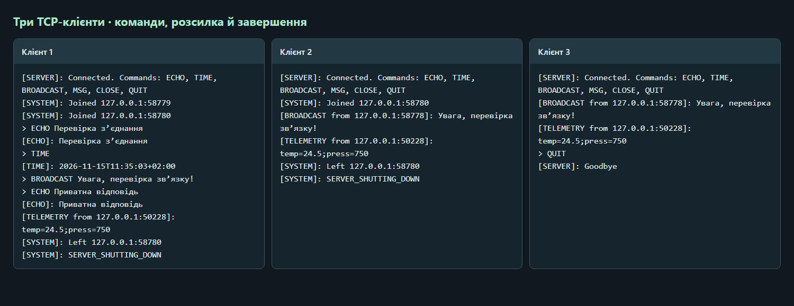

# Практична робота № 2. Сокетне програмування TCP/UDP

Device & Dispatcher Gateway приймає команди диспетчерів через TCP та показники датчиків через UDP. Сервер розсилає події активним TCP-клієнтам і сповіщає їх перед зупинкою.

## Запуск

Потрібен Go 1.22 або новіший. У корені проєкту запусти сервер:

```powershell
go run .
```

Сервер слухає `127.0.0.1:9000` для TCP та `127.0.0.1:9001` для UDP. Параметри `-tcp` і `-udp` задають інші адреси або порти. У трьох окремих терміналах запусти TCP-клієнт:

```powershell
go run ./cmd/client
```

Після підключення введи, наприклад:

```text
ECHO Перевірка з’єднання
TIME
BROADCAST Увага, перевірка зв’язку!
```

`ECHO` і `TIME` повертають відповідь у поточний термінал. `BROADCAST` отримують інші клієнти. Коли хтось підключається або виходить, активні клієнти отримують системну подію.

У четвертому терміналі надішли одну UDP-датаграму з показниками:

```powershell
go run ./cmd/client -udp 'temp=24.5;press=750'
```

Усі підключені TCP-клієнти отримають рядок `[TELEMETRY from <адреса>]: temp=24.5;press=750`. За наявності Netcat можна також використати `nc localhost 9000` для TCP або `nc -u localhost 9001` для UDP. Параметр `-addr` у Go-клієнті задає іншу адресу сервера.

Для перевірки завершення введи `QUIT` в одному клієнті й натисни `Ctrl+C` у терміналі сервера. Клієнт із `QUIT` отримає `[SERVER]: Goodbye`, а ті, хто ще підключений, отримають `[SYSTEM]: SERVER_SHUTTING_DOWN` перед закриттям TCP-з’єднання.

## Протокол

TCP-команди та відповіді передаються рядками UTF-8. Сервер приймає `LF` і `CRLF`. Максимальна довжина команди становить 4096 байтів без роздільника. Завеликий рядок завершує сесію після відповіді з помилкою.

| Команда | Результат |
| --- | --- |
| `ECHO <текст>` | Повертає `[ECHO]: <текст>` тільки відправнику. |
| `TIME` | Повертає поточний час у RFC 3339. |
| `BROADCAST <текст>` або `MSG <текст>` | Передає повідомлення іншим активним TCP-клієнтам. |
| `CLOSE` або `QUIT` | Підтверджує вихід і закриває з’єднання. |
| Невідома команда | Повертає помилку й перелік команд. |

Одна UDP-датаграма містить один текстовий показник до 1024 байтів. Сервер ігнорує завеликі пакети, порожні повідомлення та невалідний UTF-8. Потік телеметрії передається всім активним TCP-клієнтам.

## Обробка підключень і зупинка

- `net.Listen` і `Accept` приймають TCP-з’єднання. Для кожного клієнта окрема горутина читає буферизовані рядки, а горутина запису послідовно передає повідомлення з черги.
- `sync.Mutex` захищає список активних клієнтів і постановку повідомлень у черги. Запис у мережу відбувається після звільнення блокування. Якщо черга переповнюється, сервер закриває з’єднання повільного клієнта, щоб інші продовжили отримувати події.
- `net.ListenPacket` і `ReadFrom` приймають UDP паралельно з TCP. Кожна подія містить адресу датчика.
- `signal.NotifyContext` перехоплює `os.Interrupt` і `SIGTERM` на платформах, де вони надходять від ОС. Під час зупинки сервер закриває слухачі, ставить у чергу фінальну подію та чекає завершення горутин. Завислі клієнтські сокети примусово закриваються після двох секунд.

## Перевірка

Пройшли автоматичні тести команд, фрагментації TCP, UDP, розсилки, відключення та зупинки. Окремо запущено зібраний із `-race` сервер і три Go-клієнти. Два клієнти паралельно надіслали 100 повідомлень, третій отримав усі 100. UDP-подію отримали всі три. Сигнал `CTRL_BREAK_EVENT` у Windows запустив штатне завершення. Сервер вийшов із кодом 0, а детектор не зафіксував `DATA RACE`.

```powershell
go test ./...
go vet ./...
go build ./...
```

Для запуску детектора у Windows потрібні CGO та сумісний MinGW-w64 `gcc` у `PATH` (у перевірці використано w64devkit).

```powershell
$env:CGO_ENABLED = '1'
go test -race -count=3 ./...
go run -race .
```

Скриншоти сформовано з фактичного виводу програми.



[Журнал TCP/UDP-сервера, зібраного з детектором гонок](docs/screenshots/server.png)

## Контрольні питання

1. **Як відрізняються TCP- і UDP-сокети?** У TCP `Listen` і `Accept` створюють окремі з’єднання, з яких читають і в які пишуть потік байтів. У UDP `ListenPacket` повертає один сокет. `ReadFrom` повертає датаграму разом з адресою її джерела.
2. **Чому TCP потребує роздільників?** TCP зберігає порядок байтів, а один `Read` може повернути фрагмент команди або кілька команд. Протокол застосунку позначає межі за допомогою роздільника, наприклад `\n`, або префікса довжини.
3. **Навіщо горутина на клієнта?** Код може читати блокуючим викликом і працювати з кожним з’єднанням окремо. Середовище Go планує багато горутин на меншій кількості потоків ОС.
4. **Навіщо м’ютекс для колекції клієнтів?** Кілька горутин можуть одночасно додавати, видаляти й обходити карту. М’ютекс захищає ці операції. Конкурентний доступ до звичайної карти з одночасним записом може призвести до гонки чи аварійного завершення.
5. **Коли варто використовувати UDP?** Коли кожне оновлення має самостійну цінність і наступний пакет швидко замінює попередній. Приклади включають часту телеметрію, голос у реальному часі та мережеві ігри. UDP не гарантує доставку чи порядок.
6. **Для чого Graceful Shutdown?** `os/signal` передає програмі сповіщення від ОС. Сервер може припинити приймання, попередити клієнтів, закрити сокети й дочекатися завершення горутин.
7. **Чи можуть підключатися клієнти іншими мовами?** Так. Достатньо відкрити сокет і дотримуватися формату команд, кодування та обмежень. Наприклад, десктопний клієнт на C# може використати `TcpClient`.

Джерела для контрольних питань. [Go `net`](https://pkg.go.dev/net), [детектор гонок Go](https://go.dev/doc/articles/race_detector).
